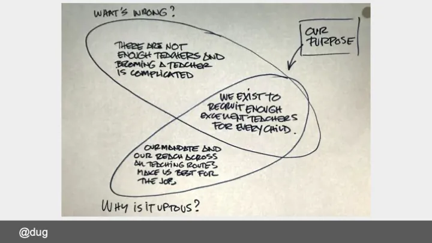

If you were to do an all-hands employee survey, asking that question, would your organisation respond as one with a clear statement?

They might, sometimes... In my experience, the teams I engage with are more often operating in a more ambiguous space. There isn't a one-size-fits-all solution to this problem, but teams benefit from pausing the moving train for a couple of hours to reflect on why they do what they do. This kind of workshop helps build the narrative for change and supports bringing all your colleagues along with you. It a valuable part of building a shared vision.

Yes, I facilitate this kind of work session but you can do it yourself. You need to ask your team to complete the butterfly canvas. You can grab a pdf here if you'd like to have a go: http://goodlookslikethis.com/i/purpose/purpose-butterfly.pdf

Simply put, this is a Venn diagram with in one circle a statement of <em>“what’s wrong”</em> and in the other <em>“why is it up to us to fix it”</em> (This can also be expressed as <em>“what’s unique about us”</em>). Put another way, you're looking to capture both your problem and your superpower:-)

The intersection of the two circles is your organisation’s “elevator pitch”. Write this down and stick it to the canvas. Why not have a go?

<em>The purpose butterfly tool isn't mine. I learned it from Melissa Andrada  (https://twitter.com/melissaandrada) at Wolff Olins.</em>

